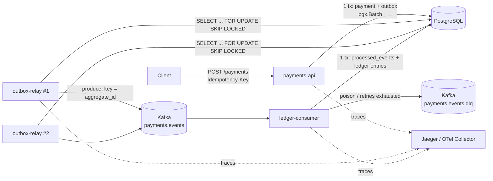

# Transactional Outbox in Go — Architecture

A small payments system that shows how to publish domain events **reliably**
from PostgreSQL to Kafka without distributed transactions.

**Guarantee:** at-least-once delivery from the outbox, plus an idempotent consumer,
gives **effectively-once processing**. The system never claims "exactly-once delivery".

---

## 1. Scope

| In scope | Out of scope |
|---|---|
| Payment create/capture API with an idempotency key | AuthN/AuthZ, multi-tenancy |
| Business row + outbox row written in one transaction (`pgx.Batch`) | Kubernetes manifests, Helm |
| N relay workers using `FOR UPDATE SKIP LOCKED` | Debezium/CDC (covered in an ADR as the alternative) |
| Per-aggregate ordering | Schema registry, Avro/Protobuf (JSON is enough here) |
| Idempotent ledger consumer + DLQ | Real PSP integration |
| OpenTelemetry trace across HTTP → DB → Kafka → consumer | |
| Integration tests with testcontainers-go, including crash scenarios | |
| Money as `int64` minor units + ISO 4217 currency | |

---

## 2. Components



| Binary | Responsibility | Scales by |
|---|---|---|
| `cmd/payments-api` | HTTP API, writes the payment and the outbox event atomically | Replicas behind an LB |
| `cmd/outbox-relay` | Polls the outbox, publishes to Kafka, marks rows as published | Replicas; `SKIP LOCKED` splits the work |
| `cmd/ledger-consumer` | Consumes `payment.captured`, writes double-entry ledger rows exactly once | Kafka consumer group (≤ partitions) |

In production you might run the relay inside the API process. Here it is a separate
binary so you can scale it on its own and kill it in tests.

---

## 3. Repository layout

```
.
├── cmd/
│   ├── payments-api/
│   ├── outbox-relay/
│   └── ledger-consumer/
├── internal/
│   ├── money/            # Money, Currency (ISO 4217 + exponent), safe arithmetic
│   ├── payment/          # domain: aggregate, state machine, events
│   ├── payment/postgres/ # repository; writes payment + outbox in one batch
│   ├── event/            # wire contract: Envelope, Encode/Decode, header keys, golden files
│   ├── outbox/           # Queue (enqueue in caller's batch), BuildRecord, Producer iface, Relay
│   │   └── outboxtest/   # FakeProducer
│   ├── ledger/           # double-entry posting logic + repository
│   ├── consumer/         # Handler iface, Permanent errors, DLQ iface; naive Poll (M2) → Processor/Runner (M4)
│   │   └── consumertest/ # FakeDLQ
│   ├── kafkax/           # outbox.Producer over franz-go, header carrier for OTel (M6)
│   ├── telemetry/        # OTel tracer/meter providers, propagators
│   ├── httpapi/          # handlers, RFC 9457 problems, middleware (recovery, logging; otelhttp in M6)
│   └── testenv/          # testcontainers harness (build tag: integration)
├── cmd/migrate/          # applies embedded migrations (used by `make up`)
├── migrations/           # goose SQL migrations, embedded; Up() shared by cmd/migrate and testenv
├── test/e2e/             # cross-component suites (F5, F10)
├── deploy/
│   ├── .env              # image versions: single source for compose AND testcontainers
│   └── docker-compose.yml  # postgres, redpanda (+ topic init), later jaeger and the 3 binaries
├── docs/
│   ├── ARCHITECTURE.md
│   ├── api-errors.md     # problem types, idempotency semantics
│   └── adr/
├── Makefile
└── .github/workflows/ci.yml
```

**Stack:** Go (latest stable), `jackc/pgx/v5`, `twmb/franz-go`, `pressly/goose`,
`net/http` (Go 1.22+ routing), `log/slog`, OpenTelemetry Go SDK,
`testcontainers-go` (postgres + redpanda modules), `golangci-lint` (run in Docker).

Integration tests of one component live next to it (`*_integration_test.go`,
`//go:build integration`). Only tests that span several binaries live in `test/e2e/`.

**Dependency rule:** `event` imports nothing internal. `outbox` and `consumer` import
`event` but not each other. `kafkax` implements `outbox.Producer` (interfaces are declared
by the package that consumes them).

---

## 4. Money

Payments people spot this one quickly, so it is strict from day one.

```go
package money

type Currency struct {
    code     string // ISO 4217 alpha-3, e.g. "EUR"
    exponent uint8  // EUR=2, JPY=0, KWD=3
}

type Money struct {
    Amount   int64    // minor units: 1999 = €19.99
    Currency Currency
}

func (m Money) Add(o Money) (Money, error)   // ErrCurrencyMismatch, ErrOverflow
func (m Money) Neg() (Money, error)          // ErrOverflow for math.MinInt64
func Parse(amountMinor int64, code string) (Money, error) // ErrUnknownCurrency
```

Rules:
- No `float64` anywhere: not in the domain, not in JSON, not in SQL.
- DB: `amount_minor BIGINT NOT NULL`, `currency CHAR(3) NOT NULL CHECK (currency ~ '^[A-Z]{3}$')`.
- JSON: `{"amount_minor": 1999, "currency": "EUR"}`. Note in the README that JS clients lose
  precision above 2^53, which is why some APIs send the amount as a string.
- Overflow-checked arithmetic (`math/bits` or explicit bounds checks), with table tests.
- Ledger invariant: for each transaction and currency, `SUM(amount_minor) = 0`.
  It is enforced in code and checked by a test.

---

## 5. Data model

```sql
-- payments
CREATE TABLE payments (
    id               UUID PRIMARY KEY,               -- UUIDv7
    idempotency_key  TEXT NOT NULL UNIQUE,
    merchant_id      TEXT NOT NULL,
    amount_minor     BIGINT NOT NULL CHECK (amount_minor > 0),
    currency         CHAR(3) NOT NULL,
    status           TEXT NOT NULL,                   -- created | captured | failed
    version          INT  NOT NULL,                   -- aggregate version, +1 per event
    capture_idempotency_key TEXT,                     -- set iff status = 'captured' (00002)
    created_at       TIMESTAMPTZ NOT NULL DEFAULT now(),
    updated_at       TIMESTAMPTZ NOT NULL DEFAULT now()
);

-- outbox
CREATE TABLE outbox (
    id                BIGINT GENERATED ALWAYS AS IDENTITY PRIMARY KEY,
    event_id          UUID   NOT NULL UNIQUE,
    aggregate_type    TEXT   NOT NULL,
    aggregate_id      TEXT   NOT NULL,                -- Kafka key
    aggregate_version INT    NOT NULL CHECK (aggregate_version >= 1),
    event_type        TEXT   NOT NULL,                -- payment.created, payment.captured
    event_version     INT    NOT NULL CHECK (event_version >= 1), -- schema version of payload
    occurred_at       TIMESTAMPTZ NOT NULL,           -- domain time, from the app clock
    payload           JSONB  NOT NULL CHECK (jsonb_typeof(payload) = 'object'), -- envelope "data"
    headers           JSONB  NOT NULL DEFAULT '{}' CHECK (jsonb_typeof(headers) = 'object'),
    created_at        TIMESTAMPTZ NOT NULL DEFAULT now(),
    attempts          INT    NOT NULL DEFAULT 0,
    next_attempt_at   TIMESTAMPTZ NOT NULL DEFAULT now(),
    last_error        TEXT,
    published_at      TIMESTAMPTZ,
    UNIQUE (aggregate_type, aggregate_id, aggregate_version)
);
CREATE INDEX outbox_pending      ON outbox (id)                WHERE published_at IS NULL;
CREATE INDEX outbox_pending_aggr ON outbox (aggregate_id, id)  WHERE published_at IS NULL;

-- consumer side
CREATE TABLE processed_events (
    consumer     TEXT NOT NULL,                       -- 'ledger'
    event_id     UUID NOT NULL,
    processed_at TIMESTAMPTZ NOT NULL DEFAULT now(),
    PRIMARY KEY (consumer, event_id)
);

CREATE TABLE ledger_entries (
    id             BIGINT GENERATED ALWAYS AS IDENTITY PRIMARY KEY,
    transaction_id UUID   NOT NULL,                   -- groups the debit/credit pair
    account        TEXT   NOT NULL,                   -- e.g. merchant:{id}:payable
    amount_minor   BIGINT NOT NULL,                   -- signed: + debit / - credit
    currency       CHAR(3) NOT NULL,
    event_id       UUID   NOT NULL,
    created_at     TIMESTAMPTZ NOT NULL DEFAULT now()
);
```

`UNIQUE (aggregate_type, aggregate_id, aggregate_version)` turns "+1 version per event" into
a database guarantee and catches concurrent writers to one aggregate.

The full schema (with `CHECK`s on `payments` and `ledger_entries`) is in
`migrations/00001_init.sql` and `00002_capture_idempotency_key.sql`.

Cleanup: a periodic `DELETE FROM outbox WHERE published_at < now() - interval '7 days'`
in batches. The ADR notes partitioning by `created_at` as the high-volume option.

### Event envelope (Kafka value)

```json
{
  "event_id": "0192f0c4-...",
  "event_type": "payment.captured",
  "event_version": 1,
  "aggregate_type": "payment",
  "aggregate_id": "0192f0c1-...",
  "aggregate_version": 2,
  "occurred_at": "2026-11-08T12:00:00Z",
  "data": { "payment_id": "...", "merchant_id": "m_42",
            "amount": { "amount_minor": 1999, "currency": "EUR" } }
}
```

Kafka **key** = `aggregate_id`. Kafka **headers**: `event_id`, `event_type`,
`content-type`, `traceparent`, `tracestate`.

Contract rules (`internal/event`):
- `payload` holds only `data`. The relay builds the envelope from the columns, so there is one
  source of truth and the columns stay queryable.
- `event_id`, `event_type`, `content-type` are **reserved** headers: the relay sets them from
  columns, and keys with these names in `outbox.headers` are dropped. Everything else in
  `outbox.headers` (a `map[string]string`, i.e. `propagation.MapCarrier`) is copied as is.
- `occurred_at` comes from the app clock and is encoded in UTC.
- `Decode` ignores unknown envelope fields (adding a field is compatible) and wraps every
  failure in `event.ErrMalformed`, which the consumer classifies as permanent.
- Golden files in `internal/event/testdata/*.json` pin the format, compared as JSON (JSONB
  reorders keys). Changing them is a contract change: `go test ./internal/event -update`.
- A test checks that `amount_minor = 2^53+1` survives Go → JSONB → envelope → Go exactly.

---

## 6. Write path: business row + outbox in one transaction

```go
func (r *Repo) Create(ctx context.Context, p payment.Payment, msg outbox.Message) error {
    return pgx.BeginFunc(ctx, r.pool, func(tx pgx.Tx) error {
        b := &pgx.Batch{}
        b.Queue(insertPaymentSQL, p.ID, p.IdempotencyKey, /* ... */)
        if err := outbox.Queue(ctx, b, msg); err != nil { // validates, appends the INSERT
            return err
        }
        return tx.SendBatch(ctx, b).Close()           // one round trip; any error -> rollback
    })
}
```

`outbox.Queue(ctx, *pgx.Batch, Message) error` is a function, not an interface: nothing needs
to mock it, and it is tested against real Postgres.

- The two inserts go in one network round trip and commit or roll back together.
- `outbox.Queue` fills the row's headers with `otel.GetTextMapPropagator().Inject(ctx, ...)`
  while the HTTP span is active, so the trace survives the async gap. Until M6 the global
  propagator is a no-op and headers stay `{}`; nothing changes in the signature later.
- **Writer invariant:** events of one aggregate are queued while holding a lock on it
  (`FOR UPDATE` on the payment, or the payment row not being committed yet). Otherwise
  `outbox.id` order can differ from commit order and the ordering guard in §7 breaks.
- **API idempotency:** a unique violation on `idempotency_key` returns the existing payment
  with `200` instead of `201`. Client retries never create a second payment or a second event.
  The same key with a different request gets `422` (not `409`: no "still in progress" state
  is ever visible, because the key is claimed by the payment's own transaction). Errors are
  RFC 9457 problem details. See [api-errors.md](api-errors.md).
- **Capture** (`POST /payments/{id}/capture`, also with `Idempotency-Key`) goes through
  `Repo.Update(ctx, id, fn)`: `SELECT ... FOR UPDATE` on the payment, then
  `payment.Capture(key, now)` decides, then `UPDATE payments` + `outbox.Queue` in one batch.
  Every state change goes through `Update`, so the writer invariant holds by construction;
  `Update` also rejects a change whose version is not exactly +1 or whose event doesn't match.
- **Capture idempotency:** the key is stored on the payment (`capture_idempotency_key`) in
  the same tx as the status change. Captured with this key → `200` +
  `Idempotent-Replayed: true`, no write. Captured with another key, or not in `created`
  → `409` `invalid-state-transition`. Concurrent captures queue on the row lock: one emits
  `payment.captured`, the rest see the result.

---

## 7. Relay: polling with `FOR UPDATE SKIP LOCKED`

### Claim query (ordered per aggregate)

```sql
SELECT o.id, o.event_id, o.aggregate_type, o.aggregate_id, o.aggregate_version,
       o.event_type, o.event_version, o.occurred_at, o.payload, o.headers, o.attempts
FROM outbox o
WHERE o.published_at IS NULL
  AND o.next_attempt_at <= now()
  AND NOT EXISTS (                       -- an earlier event for the same aggregate
        SELECT 1 FROM outbox p           -- is still unpublished (pending or in flight)
        WHERE p.aggregate_id = o.aggregate_id
          AND p.published_at IS NULL
          AND p.id < o.id)
ORDER BY o.id
LIMIT $1
FOR UPDATE SKIP LOCKED;
```

`SKIP LOCKED` lets N workers share the table without blocking each other. On its own
it breaks ordering: worker B can publish `captured` while worker A is still
publishing `created`. The `NOT EXISTS` guard fixes that. The next event for an
aggregate becomes visible only after the previous one is **committed as published**.
Different aggregates are still processed in parallel.

### Loop (one worker)

```
loop (until ctx is cancelled):
  BEGIN
    rows := claim(batchSize)                   -- locks held until COMMIT
    if empty: COMMIT; sleep(pollInterval); continue
    errs := producer.Produce(ctx + PublishTimeout, records)
    -- one round trip:
    UPDATE outbox SET published_at = now()             WHERE id = ANY(ok_ids)
    UPDATE outbox SET attempts = attempts + 1,
                      next_attempt_at = now() + backoff(attempts + 1),
                      last_error = $err                FROM unnest(failed_ids, delays, errs)
  COMMIT
  full batch → next cycle at once; otherwise sleep(pollInterval)
```

Design choices:
- **Locks stay held during publish (tx open).** If the worker dies, Postgres rolls back and
  releases the rows automatically. No lease bookkeeping. The lease-based alternative
  (`locked_until` column, short transactions) is described in an ADR.
- **Per-record failures.** A record that fails to publish, or a row that can't be turned
  into a record at all (hand-written, fails envelope validation), is rescheduled with its
  own backoff (jitter per row) and its error in `last_error`; the rest of the batch is
  marked. `RunOnce` reports them as `*PublishError` after the commit. A failing event blocks
  only its own aggregate: the guard keeps later events of it unclaimed (`attempts = 0`).
- **Cycle failures** (DB down, tx aborted) roll back everything. `Run` logs them and retries
  after `Backoff(consecutive failures)` instead of spinning at `PollInterval`.
- **Relay failures are infrastructure failures** (broker down), not poison messages, so the
  relay retries forever with capped exponential backoff and jitter. There is no DLQ on the
  producer side. Alerting uses the lag metric.
- **Producer:** franz-go with idempotence on and `acks=all`, behind the `outbox.Producer`
  interface: `Produce(ctx, []Record) []error`, one error per record by index, which maps
  directly to `ok_ids` / `failed_ids`. Records are built with
  `key=aggregate_id`, so per-aggregate order is also kept inside the Kafka partition.
- Optional: `LISTEN/NOTIFY` wake-up to cut latency below `pollInterval`.

### Batch size and poll interval

- **`BatchSize` (100)** bounds the rows locked by one worker, the records in one `Produce`
  call and the size of the mark round trip. A batch is as slow as its slowest record, and
  a failure makes the whole batch wait for the delivery timeout, so bigger is not always
  better. Because of the guard, **a batch holds at most one event per aggregate**: an
  aggregate with k pending events needs k cycles, whatever the batch size.
- **`PollInterval` (200ms)** is the latency when idle and the idle query load
  (workers / interval claims per second, each an index scan of the pending rows). A full
  batch skips the sleep, so a backlog drains at full speed. Below ~50ms, `LISTEN/NOTIFY`
  is the better tool.
- Both are set per process: `RELAY_BATCH_SIZE`, `RELAY_POLL_INTERVAL`.

### Timeouts: idle_in_transaction_session_timeout vs. the producer

Publishing happens inside the claiming tx, and Postgres counts that time as idle in
transaction. The timeouts are therefore chained, inner to outer:

| Timeout | Value | Bounds | Set in |
|---|---|---|---|
| franz-go delivery timeout | 10s | one record (enforced, see below) | `kafkax.DefaultDeliveryTimeout` |
| `Config.PublishTimeout` | 15s | one `Produce` call, any `Producer` | ctx deadline in `RunOnce` |
| `idle_in_transaction_session_timeout` | 30s | a relay that froze mid-batch (GC, SIGSTOP, partition) | `outbox.ConfigurePool` (`RuntimeParams`) |

If the server timeout fired before a healthy but slow publish ended, the server would kill
the session after the records landed: the mark is lost and every slow batch is published
twice (`TestRelay_PublishPastIdleTimeoutRollsBack` shows it). So `Run` reads the setting
at start-up and **refuses to run if it is not greater than `PublishTimeout`**; `0`
(disabled) only gets a warning.

- **The delivery timeout must really fire.** By default franz-go never fails an idempotent
  record that is already in flight: with a hung broker, `ProduceSync` blocks until the
  broker answers, ignoring `RecordDeliveryTimeout` and ctx (seen in the harness smoke test).
  `kafkax.ProducerOpts` therefore sets `AllowIdempotentProduceCancellation()` and
  `ProduceRequestTimeout` = `RequestTimeoutOverhead` = timeout/2. Cost: a record failed in
  flight may still have landed, so the retry can duplicate it. That is the same
  at-least-once duplicate as F5, which the consumer dedups. Ordering is not affected: the
  next event of an aggregate is claimed only after the previous one is marked published.

### Stopping a worker mid-batch

Cancelling a batch halfway is always *safe* (the tx rolls back, rows stay pending) but
not free: records that already landed are published again by the next relay. So `Run`
shuts down gracefully:

1. On ctx cancellation (SIGTERM), `Run` stops claiming and stops sleeping.
2. The in-flight cycle runs on `context.WithoutCancel(ctx)`, so `Produce`, the mark and
   the `COMMIT` complete: no loss, no duplicate.
3. That is bounded by **`DrainTimeout`** (default `PublishTimeout` + 5s = 20s, below the
   default 30s Kubernetes grace period). Past it, the cycle's context is cancelled: the tx
   rolls back and its rows stay pending with no attempt counted (shutdown is not a broker
   failure). The relay logs it; the next relay publishes them, possibly as duplicates.
4. `kill -9` skips all of this and is still safe: Postgres releases the locks when the
   connection drops (F5).

`RunOnce` has no drain: cancelling its ctx aborts at once. Tests use that for crash-like
steps.

### Relay API

```go
func NewRelay(pool *pgxpool.Pool, p Producer, cfg Config) *Relay
func (r *Relay) Run(ctx context.Context) error            // loops until ctx is cancelled, drains, returns nil
func (r *Relay) RunOnce(ctx context.Context) (int, error) // one claim/publish/mark cycle; tests step with it
func ConfigurePool(c *pgxpool.Config)                     // idle_in_transaction_session_timeout, application_name

type Config struct {
    Topic          string        // tests use a unique topic each
    BatchSize      int           // 100
    PollInterval   time.Duration // 200ms
    PublishTimeout time.Duration // 15s; must be < idle_in_transaction_session_timeout
    DrainTimeout   time.Duration // 20s; how long a shutdown waits for the in-flight batch
    Backoff        Backoff       // func(attempt int) time.Duration; ExpBackoff = capped exp + equal jitter
    Hooks          Hooks         // test-only seams, nil in production
}
```

### Metrics (M6)
`outbox_pending_total`, `outbox_oldest_pending_age_seconds` (the main SLO signal),
`outbox_publish_duration_seconds`, `outbox_publish_failures_total`.

---

## 8. Consumer: idempotency + DLQ

### Idempotent handling

```
for each record (partition order):
  BEGIN
    INSERT INTO processed_events(consumer, event_id) VALUES ('ledger', $id)
      ON CONFLICT DO NOTHING
    if rowsAffected == 0: COMMIT; continue          -- duplicate, already applied
    ledger.Post(tx, debit, credit)                  -- side effect, same tx
  COMMIT
commit Kafka offsets (after DB commit)
```

The dedup marker and the side effect commit **atomically**. That is why this project uses
a `processed_events` table and not Redis `SETNX`:

| Approach | Crash between marker and side effect |
|---|---|
| `processed_events` in the same PG tx | Impossible: one commit |
| Redis `SETNX` then DB write | Marker set, effect lost, so the **message is lost** |
| DB write then Redis `SETNX` | Effect applied, no marker, so it is **applied twice** |

Redis is fine when the side effect is itself idempotent or non-transactional, such as
sending a notification with a dedup TTL. The ADR covers this.

### Consumer API

```go
type Handler interface {
    // tx is shared with the processed_events insert; the caller begins and commits it.
    Handle(ctx context.Context, tx pgx.Tx, env event.Envelope) error
}
func Permanent(err error) error   // not retryable → DLQ right away; any other error is transient
func IsPermanent(err error) bool  // also true for event.ErrMalformed

type DLQ interface {
    Send(ctx context.Context, rec *kgo.Record, cause error, attempts int) error
}
```

M4 splits the implementation in two: `Processor` (dedup, tx, retries, classification), which
needs only Postgres and is mostly unit-testable, and `Runner` (franz-go poll loop, offset commit
after the DB commit, DLQ), which only F7 and F8 exercise with Kafka.

### Error handling

| Error class | Example | Action |
|---|---|---|
| Permanent | JSON decode error, unknown `event_version`, invalid currency | Send to DLQ right away |
| Transient | PG connection reset, serialization failure | In-process retry, exponential backoff, max N |
| Transient, retries exhausted | PG down for minutes | Send to DLQ (configurable: or stop consuming) |

DLQ record = original key/value plus headers: `dlq.original_topic`, `dlq.partition`,
`dlq.offset`, `dlq.error`, `dlq.attempts`, `dlq.failed_at`, and the original `traceparent`.
Optional: `cmd/dlq-replay` re-publishes DLQ messages to the main topic.
Replay is safe because the consumer is idempotent.

---

## 9. Distributed tracing (OpenTelemetry)

```
HTTP POST /payments         (server span, otelhttp)
 └─ db: insert payment+outbox
      ⋯ async gap: traceparent stored in outbox.headers ⋯
 └─ outbox.publish payments.events   (producer span, parent = extracted ctx)
      ⋯ traceparent in Kafka headers ⋯
      └─ payments.events process     (consumer span)
           └─ db: ledger post
```

- `kafkax.HeaderCarrier` implements `propagation.TextMapCarrier` over `[]kgo.RecordHeader`.
  It is written by hand on purpose, so the propagation is visible in code.
- The relay **extracts** context from `outbox.headers`, starts a `SpanKindProducer` span, and
  **injects** into the Kafka headers. The consumer extracts it and starts `SpanKindConsumer`.
- Semantic conventions: `messaging.system=kafka`, `messaging.destination.name`,
  `messaging.kafka.message.key`, `messaging.message.id=event_id`.
- docker-compose runs Jaeger. The README includes a screenshot of one trace covering all three services.

---

## 10. Failure-mode matrix

This is the core of the README: each row maps to an integration test.

| # | Where the crash or failure happens | What happens | Why it's safe | Test |
|---|---|---|---|---|
| F1 | API dies before COMMIT (create or capture) | Nothing persisted | Single tx | `TestWrite_Atomicity` |
| F2 | Outbox insert fails (e.g. constraint) | Payment write rolled back too | Single tx | `TestWrite_OutboxFailureRollsBackPayment` |
| F3 | Client retries POST (create or capture) | Same payment, no 2nd event | Unique `idempotency_key`; capture key + row lock | `TestAPI_IdempotencyKey`, `TestAPI_CaptureIdempotencyKey` |
| F4 | Two relays poll at once | Disjoint row sets | Row locks + `SKIP LOCKED` | `TestRelay_ConcurrentWorkersNoDoubleClaim` |
| F5 | **Relay dies after publish, before mark** | Row unlocked, re-published, so Kafka holds a duplicate | Consumer dedups by `event_id` | `TestRelay_CrashAfterPublishBeforeMark` |
| F6 | Kafka unavailable | Rows stay pending, `attempts` grows, published after recovery | Backoff, durable outbox | `TestRelay_BrokerOutage` |
| F7 | Consumer dies after DB commit, before offset commit | Redelivery | `processed_events` | `TestConsumer_RedeliveryIsIdempotent` |
| F8 | Poison message | Goes to DLQ, partition keeps moving | Error classification | `TestConsumer_PoisonGoesToDLQ` |
| F9 | Events for one aggregate across N relays | Published in `aggregate_version` order | `NOT EXISTS` guard + key partitioning | `TestRelay_PerAggregateOrdering` |
| F10 | Trace across async boundary | Consumer span shares the API span's trace ID | Header propagation | `TestTracing_EndToEnd` |

---

## 11. Integration tests (testcontainers-go)

### Harness (`internal/testenv`, build tag `integration`)

```go
var env *testenv.Env

func TestMain(m *testing.M) { testenv.Main(m, &env, testenv.WithPostgres(), testenv.WithKafka()) }
```

- **One Postgres and one Redpanda container per test package.** Images come from
  `deploy/.env` (overridable by env var), so tests and `make up` use the same versions.
- **A database per test, cloned from a template.** At start-up, migrations run once into
  `outbox_template`, which is then frozen (`IS_TEMPLATE`, `ALLOW_CONNECTIONS false`).
  `env.PG.NewPool(t, configure)` runs `CREATE DATABASE t_<rand> TEMPLATE outbox_template`
  (milliseconds) and drops it `WITH (FORCE)` on cleanup. Truncating shared tables would not
  work: with parallel tests, one test's relay would claim another test's rows.
- Postgres is tuned for tests: `fsync`, `synchronous_commit`, `full_page_writes` off, data on tmpfs.
- **A topic per test:** `env.Kafka.NewTopic(t, partitions)` creates it explicitly via kadm
  (no auto-create: ordering tests need several partitions). `ConsumeN` / `TryConsumeN` read from the start.
- **Broker outage = `env.Kafka.Pause(t)` / `Unpause(t)`** (docker pause), not Stop/Start. Stop/Start
  changes the mapped host port while the broker still advertises the old one, so clients
  never reconnect. Pause keeps ports, and open connections hang like a network partition.
  The smoke test checks that produce fails within the delivery timeout while paused and
  recovers on the same client after unpause.
- `testenv.Connect(t, dsn)` is the side connection that kills a backend in crash tests.
- `testenv.NoLeaks(t)` (goleak, ignoring goroutines that already existed) checks that relays
  and consumers stop cleanly. Not for tests with `t.Parallel()`.
- Fakes for unit tests: `outboxtest.FakeProducer` (per-record failure injection),
  `consumertest.FakeDLQ`, `consumer.HandlerFunc`.
- The F1–F10 tests exist from M1 as `t.Skip("M<n>")` stubs, so the failure matrix is an
  executable checklist.

### F5 in detail: "relay died after publish, before mark"

The relay has test-only seams:

```go
type Hooks struct {
    AfterClaim   func(ctx context.Context, ids []int64)                  // F4: record in-flight IDs
    AfterPublish func(ctx context.Context, tx pgx.Tx, ids []int64) error // F5: tx gives pg_backend_pid()
}
```

```mermaid
sequenceDiagram
    participant T as Test
    participant R1 as Relay #1
    participant PG as Postgres
    participant K as Kafka
    participant R2 as Relay #2
    participant L as Ledger consumer

    T->>PG: create + capture payment (outbox rows)
    R1->>PG: BEGIN; claim ... FOR UPDATE SKIP LOCKED
    R1->>K: ProduceSync(event E)  ✅ acked
    Note over R1: AfterPublish hook: pg_terminate_backend(own pid)<br/>simulates process death
    PG-->>PG: tx aborted, row lock released, published_at still NULL
    R2->>PG: claim → gets E again
    R2->>K: ProduceSync(event E)  (duplicate)
    R2->>PG: UPDATE published_at; COMMIT
    L->>K: consume E (1st) → apply, insert processed_events
    L->>K: consume E (2nd) → ON CONFLICT → skip
    T->>K: assert topic has 2 records with event_id = E
    T->>PG: assert exactly 1 ledger transaction, 1 processed_events row
```

Killing the backend from the hook (`SELECT pg_terminate_backend(pg_backend_pid())` on a
separate conn, using the PID captured at claim time) is closer to a real crash than
returning an error. The worker's tx dies on the server side, as it would after a `kill -9`.

### Other test notes
- **F4:** 8 workers, 1,000 events (200 aggregates × 5), `FakeProducer`. Assert that no
  row was claimed twice at the same moment (each worker records claimed IDs in
  `AfterClaim` and removes them after `COMMIT`; the in-flight sets never intersect), that
  every event is published exactly once, and in version order per aggregate. Run with `-race`.
- **F6:** `env.Kafka.Pause(t)` → assert `attempts >= 2`, `last_error` set,
  `published_at IS NULL`, and the aggregate's next event not even claimed →
  `env.Kafka.Unpause(t)` → `require.Eventually` published; Kafka holds every event, first
  occurrences in order. Not parallel: it pauses the package's shared broker.
- **F9:** 4 relays on a 4-partition topic, 20 aggregates × 10 events written while they
  run, 30% of publishes failing at random before Kafka. Assert each key sits in one
  partition with versions exactly 1..10 in offset order. Without the guard, a relay would
  publish v+1 while v backs off.
- Relay unit-level tests (`FakeProducer`): reschedule with backoff, ordering guard and
  head-of-line blocking, unbuildable rows, idle-timeout check, publish past the idle
  timeout, graceful shutdown and drain timeout (with `NoLeaks`).
- **F10:** `tracetest.NewInMemoryExporter()` for all three components in-process. Assert one trace ID
  and the parent/child chain.
- Unit tests (no containers) for `money`, the payment state machine, the backoff policy, and error classification.
- `make test` runs unit tests only (no Docker). `make test-integration` runs
  `go test -tags=integration -race ./...`; it starts its own containers and does not need `make up`.

---

## 12. Local run and CI

```
make up        # docker compose: postgres, redpanda + topics, migrations (later: jaeger, api, 2x relay, consumer)
make lint      # golangci-lint in Docker, as your uid
make demo      # curl script: create + capture 100 payments, print ledger balance
make chaos     # kills a relay container in a loop while demo runs; ledger stays balanced
```

GitHub Actions: `golangci-lint` → unit tests (`-race`) → integration tests
(testcontainers runs on `ubuntu-latest` without extra setup) → coverage badge.

---

## 13. ADRs (`docs/adr/`)

1. **Outbox polling vs. CDC (Debezium).** Polling is easier to run and fine for thousands of
   events/s. CDC is better for very high volume or when the app can't change.
2. **Hold row locks during publish vs. lease column.** We chose the tx-held lock because it gives
   crash safety for free. It requires a hard publish bound, hence
   `AllowIdempotentProduceCancellation` (§7) and its duplicate trade-off.
3. **`processed_events` table vs. Redis `SETNX`** for consumer idempotency (see §8).
4. **Per-aggregate ordering via `NOT EXISTS` guard.** The cost is an extra index probe and
   head-of-line blocking per aggregate, which is intended.
5. **Money as `int64` minor units.** Covers why not `float64`, why not `decimal` here, and the
   overflow limits (about 9.2·10^16 EUR).
6. **franz-go over confluent-kafka-go.** Pure Go with no cgo, and an idempotent producer by default.

---

## 14. Implementation plan

| Milestone | Deliverable | Done when |
|---|---|---|
| **M1 — Foundations** | repo skeleton, `money` + tests, migrations, docker-compose, CI; **event contract** (`internal/event` + golden files); **interfaces** (`outbox.Queue`/`Producer`/`Relay`, `consumer.Handler`/`DLQ`) with fakes; **harness** (`internal/testenv`) + smoke tests; F1–F10 stubs | `make up` works, lint, unit and integration tests green ✅ |
| **M2 — Walking skeleton** | `POST /payments` → `pgx.Batch` repo → naive relay (no `SKIP LOCKED`, no retries, single instance) → Kafka → consumer that only logs; UUIDv7 ids, RFC 9457 errors, API idempotency (same key + different body → 422) | F1–F3 and the end-to-end test pass ✅ |
| **M3 — Hardening the write path and the relay** | capture endpoint with `Idempotency-Key` (`Repo.Update` under `FOR UPDATE`); claim/publish/mark in one tx with `SKIP LOCKED` + `NOT EXISTS` ordering guard, per-record backoff, timeout chain checked at start-up, graceful shutdown with drain timeout. Metrics move to M6 (OTel meters) | F1–F4, F6, F9 pass; `TestEndToEnd_PaymentEventsReachConsumer` covers create + capture ✅ |
| **M4 — Consumer** | ledger double-entry, `processed_events`, retry + DLQ | F7, F8 tests pass |
| **M5 — Crash scenario** | `Hooks.AfterPublish`, F5 test, `make chaos` | F5 test passes, chaos run leaves ledger balanced |
| **M6 — Tracing and metrics** | OTel across all three services, Jaeger in compose; relay metrics from §7 | F10 test passes, screenshot in README |
| **M7 — Polish** | README (diagram, guarantees, failure matrix), ADRs, simple load numbers | A reviewer gets the point in 2 minutes |

**README order:** one-line pitch → diagram → "Guarantees" → failure-mode matrix with
links to the tests → quickstart (`make up && make demo`) → Jaeger screenshot → ADR links.
